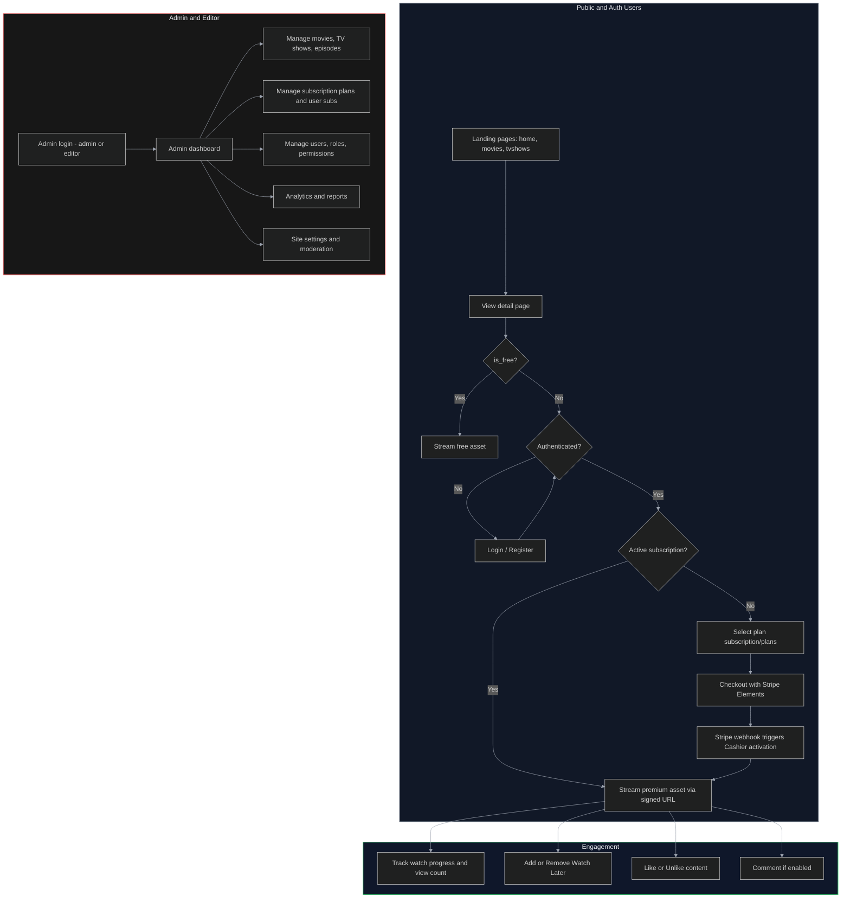

# App Process Flows

Mermaid diagrams summarizing primary flows: browsing/streaming, subscription lifecycle, user interactions, and admin operations.

Use this as a prompt-ready overview of how users, subscriptions, content access, and admin functions flow through the app.
