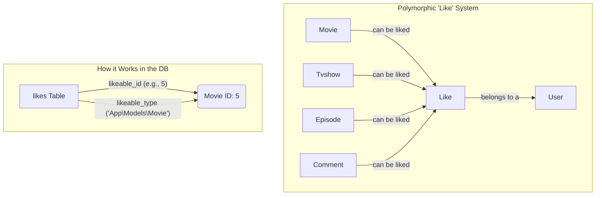

# How I Built a Netflix Clone: A Deep Dive into Libeflix

*Hi there! I'm excited to walk you through my project, Libeflix. It's my take on a full-featured streaming platform like Netflix. In this post, I'll break down how I built it, the technical challenges I faced, and the stack I used. Let's dive in!*


*(Image: The Libeflix homepage, featuring carousels of movies and TV shows, with a modern, dark-themed UI.)*

---

## 1. What is Libeflix? The Big Picture

At its heart, Libeflix is a streaming platform I built from scratch to challenge myself and showcase my skills. It's not just a simple clone; I aimed to build a production-ready application with many of the complex features you'd expect from a real-world service.

Here are some of the key things you can do on Libeflix:

-   **A Modern UI**: I designed a responsive and intuitive interface for browsing movies and TV shows.
-   **Secure Video Streaming**: I implemented a system to deliver video content securely, protecting premium content.
-   **Subscription System**: Users can subscribe to different plans to access premium content, powered by Stripe.
-   **Advanced Search**: I built a real-time search engine that gives you results as you type.
-   **Social Features**: You can like content, leave comments (with replies!), and build a community.
-   **"Watch Later" List**: A handy feature to save any movie, TV show, or even a specific episode for later.
-   **Admin Dashboard**: I built a comprehensive backend panel to manage users, content, and see how the platform is doing.
-   **Roles & Permissions**: Not everyone has the same access. I created a system for different user roles (like admins and regular users).

---

## 2. My Tech Stack: The Tools for the Job

To build a project this complex, I had to pick the right tools. I chose technologies that are powerful, modern, and that I'm passionate about. Here's a look at my tech stack.

### **On the Backend (The Engine)**

-   **Laravel & PHP**: I used Laravel, a fantastic PHP framework. It provides a solid foundation with a lot of built-in features that sped up development.
-   **MySQL/SQLite**: For my database, I set it up to be flexible. I use SQLite for local development to keep things simple and MySQL in production for performance.
-   **Laravel Cashier & Stripe**: To handle payments and subscriptions, I used Laravel Cashier. It makes integrating with Stripe a breeze.
-   **Spatie's Laravel Permission**: This package was a lifesaver for managing user roles and permissions.

### **On the Frontend (The User Interface)**

-   **React & TypeScript**: I built the user interface with React. Using TypeScript from the start helped me catch bugs early and keep my code clean and maintainable.
-   **Inertia.js**: This is one of my favorite tools. It let me build a super-fast, single-page application (SPA) experience without the hassle of building a separate API. It's the glue between my Laravel backend and React frontend.
-   **Tailwind CSS**: For styling, I used Tailwind CSS. It allowed me to build a custom design system quickly without writing a lot of custom CSS.

---

## 3. How I Approached the Project

I didn't just jump into coding. I started by thinking about the big picture, following a process similar to **Domain-Driven Design**. I broke the project down into logical phases:

1.  **The Foundation**: First, I built the basics: user sign-up, login, and profile management.
2.  **Content is King**: Next, I figured out how to handle movies and TV shows. This is where I designed the core data structures, including the tricky relationships between TV shows, seasons, and episodes.
3.  **Let's Stream!**: Then came the main event: video streaming. I focused on making it secure and efficient.
4.  **Finding Your Show**: With content in place, I built the search engine.
5.  **Making it Social**: I added the "fun" stuff: likes and comments.
6.  **The Business Side**: I integrated the Stripe subscription system and built the logic to protect premium content.
7.  **Making it Fast**: Throughout the project, and especially at the end, I focused on performance—optimizing database queries and making the frontend load quickly.

---

## 4. Diving Into the Code: Cool Features and How I Built Them

Let's get into the technical details. Here are some of the most interesting challenges I tackled and how I solved them.

### **Challenge #1: Streaming Video Securely**

I couldn't just have a public link to my video files. I needed to make sure only subscribed users could watch premium content.

My solution was a multi-step security process. I built a custom middleware in Laravel that checks a user's permissions before it serves a video file. I also obfuscated the file paths so users couldn't guess the URLs.

Here's a simplified look at the middleware I wrote:

```php
// app/Http/Middleware/CheckPremiumContent.php

class CheckPremiumContent {
    public function handle(Request $request, Closure $next): Response {
        // First, I get the encoded file path from the URL.
        $encFilePath = $request->route('encFilePath');
        
        // I decode the path to find the actual file location.
        $decodedPath = Tool::decode($encFilePath);
        $movie = Movie::where('path', $decodedPath)->first();
        
        // If the movie is premium (not free)...
        if ($movie && !$movie->is_free) {
            // ...I check if the user is logged in and has a valid subscription.
            if (!auth()->user()?->canAccessPremiumContent()) {
                // If not, I send them to the subscription page.
                return redirect()->route('subscription.plans')
                    ->with('error', 'You need to subscribe to watch this!');
            }
        }
        
        // If everything checks out, I let them see the video!
        $response = $next($request);
        // I also add headers to prevent the browser from caching the video link.
        $response->headers->set('Cache-Control', 'no-cache, no-store, must-revalidate');
        
        return $response;
    }
}
```

This approach creates a strong security layer. Even if someone finds a video URL, they can't access it without being authenticated and subscribed.

### **Challenge #2: A "Universal" System for Likes and Watch Later**

Users should be able to "like" or "add to watch later" anything: a movie, a TV show, a season, or even an episode.

The naive approach would be to create separate database tables: `movie_likes`, `tvshow_likes`, etc. That would have been a mess to maintain. Instead, I used one of the most powerful features of Laravel's database system: **polymorphic relationships**.

This lets me use a single `likes` table for everything. Here's a diagram of how it works:



To make this work, I created a `Likeable` trait. A "trait" in PHP is like a code mixin. I can add this trait to any model (like `Movie` or `Tvshow`) to instantly make it "likeable."

Here's the code for the `Likeable` trait:

```php
// app/Traits/Likeable.php

trait Likeable {
    // This sets up the relationship: a Movie can have many Likes.
    public function likes() {
        return $this->morphMany(Like::class, 'likeable');
    }
    
    // A handy function to check if a user has already liked this item.
    public function isLikedBy(?User $user): bool {
        if (!$user) return false;
        return $this->likes()->where('user_id', $user->id)->exists();
    }
    
    // A function to get the total number of likes.
    public function likesCount(): int {
        return $this->likes()->count();
    }
}
```

By adding `use Likeable;` to my `Movie` model, it gets all these methods for free! This was a huge win for keeping my code clean and scalable. I used the exact same approach for the "Watch Later" feature.

### **Challenge #3: Building a Smart and Fast Search Bar**

I wanted the search to feel instant, showing results as the user types. But hitting the database on every single keystroke would be incredibly slow and inefficient.


*(Image: The real-time search component in action, showing a dropdown of movie posters and titles as I type in the search bar.)*

My solution was a **dual-timeout system** on the frontend, built with React and TypeScript.

1.  **Fast UI Search (300ms Debounce)**: When you type, the search doesn't fire immediately. It waits for you to pause for 300 milliseconds. This feels instant to the user but prevents a flood of requests. This search just gets the data to show on the screen.
2.  **Delayed Analytics Logging (1500ms Debounce)**: I also wanted to track what people search for to improve the platform. But I don't need to log every partial search (like "t", "th", "the"). So, a second, longer timer waits for the user to pause for 1.5 seconds. Only then does it log the search term to my analytics database.

Here's a simplified version of the React hook I wrote to handle this logic:

```tsx
// resources/js/hooks/useSearch.ts

const useSearch = () => {
  const [searchQuery, setSearchQuery] = useState('');
  const [searchResults, setSearchResults] = useState<Movie[]>([]);
  
  // I use React's `useRef` to hold the timer IDs.
  const searchTimeoutRef = useRef<NodeJS.Timeout>();
  const logTimeoutRef = useRef<NodeJS.Timeout>();

  const performSearch = useCallback(async (query: string) => {
    // I clear any existing timers first.
    if (searchTimeoutRef.current) clearTimeout(searchTimeoutRef.current);
    if (logTimeoutRef.current) clearTimeout(logTimeoutRef.current);
    
    // This is the fast timer for updating the UI.
    searchTimeoutRef.current = setTimeout(async () => {
      const response = await api.get(`/api/movies/search?q=${query}&log=false`);
      setSearchResults(response.data.results);
    }, 300);
    
    // This is the slow timer for logging the search for analytics.
    logTimeoutRef.current = setTimeout(async () => {
      await api.post('/api/movies/search/log', { query });
    }, 1500);
  }, []);

  return { searchQuery, searchResults, performSearch };
};
```

This approach gave me the best of both worlds: a super responsive UI and clean, meaningful data for my analytics.

---

## 5. My Approach to Testing: Ensuring Quality

Building features is fun, but making sure they work reliably is just as important. For a real-world application, a solid testing strategy is non-negotiable. While this is a portfolio project, I planned the testing strategy from the start. My goal is to have a suite of tests that gives me confidence to add new features or refactor code without breaking anything.

### **Backend Testing with Pest**

For the Laravel backend, I chose Pest. It has a beautiful, expressive syntax that makes tests easy to read and write. My plan covers both unit tests (testing small, isolated pieces of code) and feature tests (testing a whole feature from the outside, like making an HTTP request).

Here are a couple of examples of tests I would write.

**Testing the Premium Content Middleware:**

This test would make sure my security middleware works exactly as expected.

```php
// tests/Feature/PremiumContentMiddlewareTest.php

use App\Models\User;
use App\Models\Movie;

// Test for a subscribed user
it('allows subscribed users to access premium content', function () {
    // First, I create a user and a premium movie
    $user = User::factory()->create();
    $this->actingAs($user); // Log the user in
    $movie = Movie::factory()->create(['is_free' => false]);

    // Here, I'd simulate the user having a subscription
    // For this example, let's assume a 'subscribed' method on the User model
    $user->subscribeToPlan('premium'); 

    // Then I make a request to the streaming endpoint
    $response = $this->get(route('movie.serve', ['encFilePath' => Tool::encode($movie->path)]));

    // And I assert that the request was successful (status 200)
    $response->assertStatus(200);
});

// Test for a non-subscribed user
it('redirects non-subscribed users trying to access premium content', function () {
    $user = User::factory()->create();
    $this->actingAs($user);
    $movie = Movie::factory()->create(['is_free' => false]);

    $response = $this->get(route('movie.serve', ['encFilePath' => Tool::encode($movie->path)]));

    // I expect to be redirected to the subscription plans page
    $response->assertRedirect(route('subscription.plans'));
});
```

**Testing the Polymorphic "Like" System:**

This test ensures that the liking feature is solid.

```php
// tests/Feature/LikesTest.php

use App\Models\User;
use App\Models\Movie;

it('a user can like a movie', function () {
    $user = User::factory()->create();
    $movie = Movie::factory()->create();

    // I log in as the user and hit the "like" API endpoint
    $this->actingAs($user)->postJson("/api/movies/{$movie->slug}/like");

    // I then check the database to make sure the 'like' was recorded correctly
    $this->assertDatabaseHas('likes', [
        'user_id' => $user->id,
        'likeable_id' => $movie->id,
        'likeable_type' => Movie::class,
    ]);
});

it('a user cannot like the same movie twice', function () {
    $user = User::factory()->create();
    $movie = Movie::factory()->create();

    // The user likes the movie once...
    $movie->likes()->create(['user_id' => $user->id]);

    // If they try to like it again, I expect an error response.
    // A 409 Conflict status code is appropriate here.
    $this->actingAs($user)->postJson("/api/movies/{$movie->slug}/like")
        ->assertStatus(409);

    // And I assert that there's still only one like in the database.
    expect($movie->likes()->count())->toBe(1);
});
```

These are just a couple of examples, but they show how I'd build a safety net around my application's core features, allowing me to develop with confidence.

### **Frontend Testing**

On the frontend, I'd use tools like **Vitest** and **React Testing Library**. My focus would be on testing user interactions to make sure the UI behaves as expected.

I would write tests for things like:

-   **Component Rendering**: Does my `MoviePoster` component display correctly when I give it movie data?
-   **User Events**: When a user clicks the "like" button, is the `handleLikeToggle` function called?
-   **State Changes**: Does the like button visually update immediately after being clicked (testing the optimistic UI update)?

A combination of backend and frontend testing would ensure that Libeflix is not just feature-rich, but also robust and reliable—just like a real-world product needs to be.

---

## 6. What's Next for Libeflix?

A project like this is never truly "done." Here are some of the things I'd love to add in the future:

-   **A Recommendation Engine**: Use viewing history and likes to suggest what to watch next.
-   **Video Transcoding**: Process uploaded videos into different quality levels (like 480p, 720p, 1080p) for adaptive streaming.
-   **Real-time "Watch Parties"**: Use WebSockets to let friends watch content together and chat in real-time.
-   **Mobile Apps**: Use React Native to build native mobile apps for iOS and Android, sharing some of the web app's code.

---

## 7. Final Thoughts and What I Learned

Building Libeflix was a huge learning experience. It pushed me to think deeply about system architecture, database design, security, and user experience.

-   **Architecture is Key**: Thinking about the structure of the app before writing code saved me countless hours of refactoring later. The choice to use Inertia.js and polymorphic relationships were two of the best decisions I made.
-   **Performance Matters**: I learned that performance isn't just about fast code; it's about the user's *perception* of speed. Techniques like debouncing and optimistic UI updates make a huge difference.
-   **Security is Not an Afterthought**: I built security in from the beginning, from protecting video streams to preventing common web vulnerabilities.

### **Key Skills I Applied**

For any recruiters or interviewers reading, this project demonstrates my hands-on experience with:

1.  **Full-Stack Development**: I seamlessly connected a complex Laravel backend with a modern React frontend.
2.  **Architectural Design**: I made strategic decisions about the tech stack and database structure to build a scalable and maintainable application.
3.  **Security**: I implemented robust strategies to protect user data and premium content.
4.  **Performance Optimization**: I fine-tuned database queries and frontend rendering to deliver a fast user experience.
5.  **User Experience**: I designed and built an intuitive interface with features that users expect from a modern web app.
6.  **Real-World Business Logic**: I implemented a complete subscription and payment system, a core requirement for many applications.

Thank you for taking the time to read about my project! I had a blast building it, and I'm proud of what I was able to accomplish.

---

**Live Demo**: [Your-Deployment-URL.com](https://your-deployment-url.com)  
**GitHub Repository**: [github.com/your-username/libeflix](https://github.com/your-username/libeflix)

*If you have any questions, feel free to reach out!* 🚀 