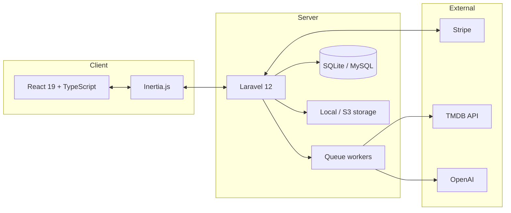

# Libeflix

Libeflix is a full-stack streaming platform I built to explore what a real video service actually involves: subscriptions, secure media delivery, real-time search, analytics, and an admin backend. It runs on Laravel and React with Inertia.js, so you get a modern single-page app without maintaining a separate API.

> **Portfolio project** · Laravel 12 · React 19 · TypeScript · Stripe · Inertia.js  
> [libe.dev](https://libe.dev) · [Blog: the hard part of a Netflix clone](https://libe.dev/blog/the-hard-part-of-a-netflix-clone-content-security/)

---

## At a glance

| | |
|---|---|
| **What it is** | A Netflix-style app for browsing and streaming movies, TV shows, seasons, and episodes |
| **Who it's for** | Viewers, subscribers, admins, and editors |
| **How it's built** | Laravel backend with an Inertia/React frontend (no separate REST API for the UI) |
| **Payments** | Stripe subscriptions through Laravel Cashier |
| **Content** | TMDB metadata import, local or S3 storage, background jobs for heavy work |
| **Tests** | Pest and PHPUnit with an in-memory SQLite database |

---

## Why I built this

Most streaming tutorials stop at a movie grid and a `<video>` tag. I wanted to go deeper and work through the problems that show up in real products: checking entitlements before playback, hiding storage paths from URLs, tracking search behavior, building admin tooling with proper roles, and handling the full subscription lifecycle.

The point wasn't to compete with Netflix on scale. It was to show I can take a product from database design and background jobs all the way to a polished UI, working payments, and useful analytics.

I wrote about one of the trickier parts on my blog: [the hard part of a Netflix clone (content security)](https://libe.dev/blog/the-hard-part-of-a-netflix-clone-content-security/).

---

## What it does

### Streaming and access control
- Free and premium content, with middleware checking access before any stream starts
- Encoded file paths so storage locations never appear in URLs
- Watch progress, view counts, and completion tracking
- Subtitle delivery alongside video

### Subscriptions and billing
- Multiple subscription plans via **Stripe** and **Laravel Cashier**
- Checkout with Stripe Elements on the frontend
- Webhooks handle activation; users can manage their plan from the app

### Search and discovery
- Real-time search across movies and TV shows (titles, cast, keywords, credits)
- TV search works at the show, season, and episode level with relevance ranking
- Search queries and clicks are logged for analytics

### Social features
- Likes, threaded comments, and shareable comment links
- Watch Later lists for movies, shows, seasons, or individual episodes
- Popular and top content rankings based on actual view data

### Admin and operations
- Full content management for movies, TV shows, seasons, and episodes
- Movie import from TMDB, processed in the background via queues
- User management with **Spatie Laravel Permission** (admin, editor, and user roles)
- Analytics dashboard with ApexCharts: views over time, completion rates, top content, peak hours and days

### Auth
- Email and password with verification
- Google sign-in through Laravel Socialite
- Routes and navigation respect roles and permissions

---

## How it's put together



When someone hits play, the app checks auth, subscription status, and whether the content is free. If everything passes, it serves the stream through an encoded URL that `StorageController` resolves on the server.

Domain logic lives in service classes (`MovieService`, `TvshowService`, `ViewService`, and others). Controllers stay thin. Imports and recommendations run on the queue so requests stay fast.

---

## Tech stack

### Backend
| Technology | Role |
|---|---|
| PHP 8.2+ | Runtime |
| Laravel 12 | Framework, routing, Eloquent, queues, Cashier |
| Inertia Laravel | Connects Laravel to the React frontend |
| Spatie Permission | Role-based access control |
| Laravel Socialite | Google OAuth |
| Laravel Cashier | Stripe billing |
| openai-php/laravel | AI-assisted metadata during import |
| Pest / PHPUnit | Tests |

### Frontend
| Technology | Role |
|---|---|
| React 19 | UI |
| TypeScript | Type safety |
| Inertia React | Page routing without a separate API |
| Tailwind CSS 4 | Styling |
| Radix UI + Headless UI | Accessible components |
| ApexCharts | Admin charts |
| Stripe Elements | Payment forms |
| Vite 6 | Build tooling |

### External services
- **Stripe** for subscriptions and checkout
- **TMDB** for movie and TV metadata and artwork
- **OpenAI** for release-year and metadata help during import

---

## Project structure

```
app/
├── Http/Controllers/     # Web and API endpoints
├── Http/Middleware/      # Premium content, roles, auth
├── Jobs/                 # Async imports and recommendations
├── Models/               # Movies, episodes, views, subscriptions, etc.
└── Services/             # Domain logic (MovieService, ViewService, etc.)

resources/js/
├── components/           # Reusable UI (admin, player, search, etc.)
├── pages/                # Inertia pages (movies, admin, settings, etc.)
└── layouts/              # App shells

tests/
├── Feature/              # Auth, admin import, views system, etc.
└── Unit/                 # Service-level tests
```

---

## Getting started

### Prerequisites
- PHP 8.2+
- Composer
- Node.js 20+
- SQLite (default) or MySQL

### Setup

```bash
# Install dependencies
composer install
npm install

# Environment
cp .env.example .env
php artisan key:generate

# Database
touch database/database.sqlite   # if using SQLite
php artisan migrate --seed

# Run everything (server, queue, Vite)
composer dev
```

### Key environment variables

| Variable | Purpose |
|---|---|
| `STRIPE_KEY` / `STRIPE_SECRET` | Stripe checkout |
| `TMDB_API_KEY` | Metadata import |
| `OPENAI_API_KEY` | Optional AI enrichment |
| Google OAuth credentials | Social login |

See `.env.example` for the full list.

### Useful commands

```bash
composer dev          # Laravel + queue + Vite together
composer dev:ssr        # Same, plus Inertia SSR and log tailing
php artisan test        # Run the test suite
npm run lint            # ESLint
npm run types           # TypeScript check
```

---

## Testing

Tests run against an in-memory SQLite database with fake storage. Nothing touches a real database file or cloud bucket.

```bash
php artisan test
```

There's coverage for auth flows, admin movie import, view-tracking logic, and profile/settings updates.

---

## What this shows

If you're reviewing this as a portfolio piece, here's what I was aiming to demonstrate:

- **Full-stack work**: schema, services, React UI, and dev tooling in one repo
- **Real monetization**: Stripe integration, not a fake paywall
- **Thoughtful media delivery**: encoded paths, middleware checks, premium gating
- **A product you can observe**: search and view analytics with an admin dashboard
- **Maintainable Laravel**: service layer, queued jobs, Spatie permissions, Pest tests
- **A modern frontend**: TypeScript, Tailwind 4, accessible Radix components, charts

---

## More documentation

The repo has deeper write-ups if you want to dig in:

| Doc | Topic |
|---|---|
| [`docs/TECHNICAL_OVERVIEW.md`](docs/TECHNICAL_OVERVIEW.md) | Full stack inventory |
| [`docs/APP_PROCESS_FLOWS.md`](docs/APP_PROCESS_FLOWS.md) | User, subscription, and admin flows |
| [`docs/SEARCH_ENGINE_DOCUMENTATION.md`](docs/SEARCH_ENGINE_DOCUMENTATION.md) | Movie search and analytics |
| [`docs/TV_SHOW_SEARCH_ENGINE_DOCUMENTATION.md`](docs/TV_SHOW_SEARCH_ENGINE_DOCUMENTATION.md) | TV search across shows, seasons, episodes |
| [`docs/ANALYTICS_SYSTEM_DOCUMENTATION.md`](docs/ANALYTICS_SYSTEM_DOCUMENTATION.md) | View tracking and reporting |
| [`docs/SUBSCRIPTION_SYSTEM_SETUP.md`](docs/SUBSCRIPTION_SYSTEM_SETUP.md) | Stripe and Cashier setup |
| [`docs/ROLES_AND_PERMISSIONS_SETUP.md`](docs/ROLES_AND_PERMISSIONS_SETUP.md) | Role and permission config |

---

## License

MIT. See [LICENSE](LICENSE) if present, or contact the repository owner.

---

<p align="center">
  <sub>
    Portfolio project by <a href="https://libe.dev">libe.dev</a> ·
    <a href="https://libe.dev/blog/the-hard-part-of-a-netflix-clone-content-security/">Read the blog post</a>
  </sub>
</p>
